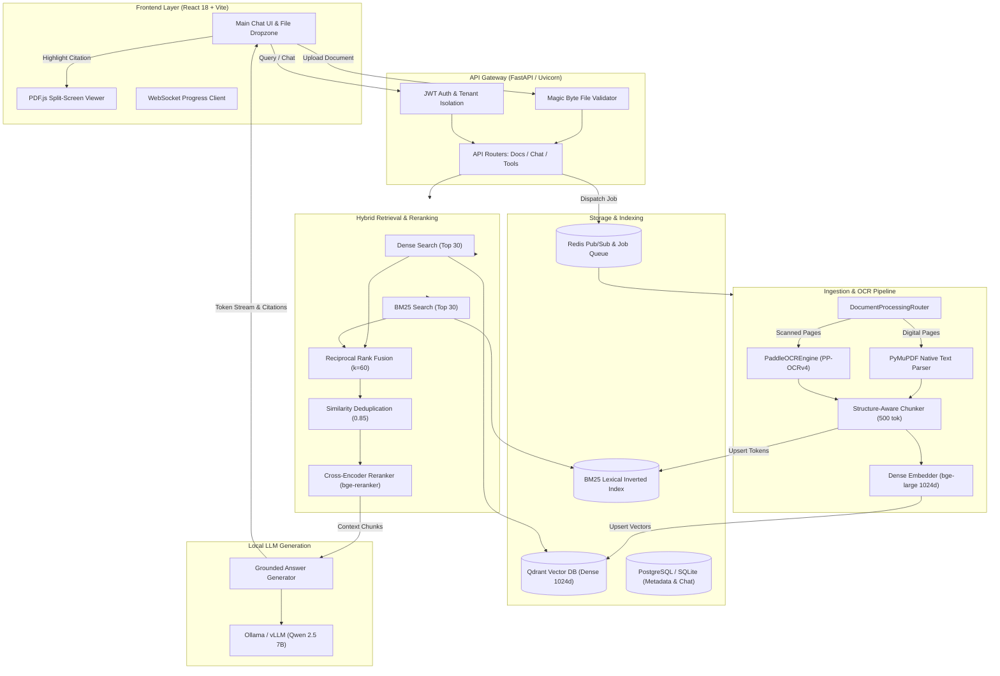

# DocuChat AI — End-to-End Architecture & Engineering Guide (v2.0.0)

**Version:** 2.0.0 (Master Upgrade Edition)  
**System Classification:** Production Document Intelligence & Multimodal RAG Platform  
**Target Environment:** Local Workstation / Containerized Cloud  

---

## 1. Project Purpose, Features & System Requirements

### 1.1 Project Mission
DocuChat AI is a high-precision, locally executable Document Intelligence and Retrieval-Augmented Generation (RAG) platform. It allows users to upload enterprise documents (PDF, DOCX, XLSX, PPTX, TXT, scanned images), inspect them in a split-screen canvas viewer, and query them using locally served large language models with strictly grounded citations and visual bounding-box highlights.

### 1.2 Core Supported Features
- **Intelligent Conditional Document Ingestion:** Zero-OCR native text extraction for digital PDFs; automatic fallback to PaddleOCR / PP-OCRv4 for scanned pages; unified handling of mixed documents.
- **Multimodal Provenance & Visual BBoxes:** Extracts and normalizes text coordinates to PDF point space (`TOPLEFT`), enabling accurate visual overlays in the PDF.js drawer across all zoom levels.
- **Structure-Aware Chunking:** Splits text by semantic headings and tables with a 500-token limit and 50-token overlap, preserving hierarchical breadcrumbs.
- **Hybrid Retrieval Engine:** Combines Qdrant dense vector search (`bge-large-en-v1.5`, 1024-dim) with BM25 lexical search using Reciprocal Rank Fusion ($k=60$).
- **Cross-Encoder Reranking & Context Thresholding:** Re-scores top fused candidates with `bge-reranker-large` and prunes low-relevance passages.
- **Grounded Generation & Anti-Hallucination:** System prompt forces strict document adherence; explicitly returns `[NO EVIDENCE]` when passages do not support a query.
- **Safe Sandboxed Tool Execution:** AST-based calculator, formula-injection-protected Excel generator, and rate-limited DuckDuckGo web search.
- **Multi-Tenant Workspace Security:** Enforces Argon2id/PBKDF2 password hashing, JWT authentication, and isolated vector retrieval filtering.
- **Resilient Background Processing:** Asynchronous job execution with Redis/WebSocket real-time progress broadcast and automatic recovery of orphaned jobs on server restart.

### 1.3 Verified System Requirements
- **Operating Systems:** Windows 10/11, Ubuntu 22.04 LTS+, macOS Sonoma+.
- **Python Runtime:** Python 3.11 – 3.14 (fully compatible with 3.14 stdlib `uuid7` and timezone-aware UTC datetime).
- **Node.js:** Node.js 18+ and npm 9+.
- **RAM:** Minimum 16 GB (32 GB recommended for local 7B LLM inference).
- **GPU (Optional):** NVIDIA GPU with CUDA 12+ for accelerated local LLM and PaddlePaddle inference; CPU execution supported out-of-the-box.
- **Optional Supporting Services:** Docker Desktop (for Qdrant, Redis, PostgreSQL, Docling-serve), LibreOffice (`soffice` headless for Office document conversion).

---

## 2. Updated System Architecture Diagram



---

## 3. Actual Services, Frameworks, Ports & Dependencies

| Service / Framework | Default Port | Internal Role | Key Dependencies |
| :--- | :---: | :--- | :--- |
| **FastAPI Backend** | `5000` | REST API, SSE streaming, WebSockets | `fastapi`, `uvicorn`, `pydantic`, `python-jose` |
| **React Frontend** | `3000` | UI, PDF canvas rendering, chat interface | `react`, `pdfjs-dist`, `lucide-react`, `vite` |
| **Qdrant Vector DB** | `6333` | Dense vector indexing & similarity search | `qdrant-client` |
| **Ollama LLM Host** | `11434` | Local model inference server | `httpx`, `langchain-community`, `ollama` |
| **Redis** | `6379` | Ingestion job queuing & progress pub/sub | `redis` |
| **PostgreSQL / SQLite** | `5432` | Relational persistence for users, jobs, chat | `sqlalchemy`, `asyncpg`, `aiosqlite`, `alembic` |
| **Docling-serve** | `5001` | Microservice container for layout analysis | `httpx` |

---

## 4. Installed AI Models & Roles

1. **Primary Generation LLM:** `qwen2.5:7b`
   - *Role:* Document-grounded reasoning, complex synthesis, anti-hallucination refusal.
   - *Context Window:* Configured up to 32,768 tokens (default operational context 8,192 tokens).
   - *Serving Engine:* Ollama / vLLM via REST streaming endpoint (`/api/generate` or `/api/chat`).
2. **Fast Rewriter LLM:** `qwen2.5:1.5b`
   - *Role:* Multi-query expansion, conversational history resolution, tool calling classification.
3. **Dense Embedding Model:** `BAAI/bge-large-en-v1.5`
   - *Dimensionality:* 1024 dimensions.
   - *Distance Metric:* Cosine similarity in Qdrant collection `docuchat_documents`.
4. **Cross-Encoder Reranker:** `BAAI/bge-reranker-large`
   - *Role:* Cross-attention rescoring of fused candidate passages.
5. **OCR Vision Model:** PaddleOCR / PP-OCRv4 (Detection + Direction Classifier + Recognition)
   - *Execution:* High-speed inference with coordinate scaling from 150 DPI pixmaps to 72 pt PDF canvas.

---

## 5. Document Ingestion Sequence

```mermaid
sequenceDiagram
    autonumber
    actor User
    participant Web as Frontend Drawer
    participant API as FastAPI Documents API
    participant Worker as Asynchronous Ingest Worker
    participant Router as DocumentProcessingRouter
    participant DB as SQLite / PostgreSQL
    participant Index as Qdrant & BM25

    User->>Web: Uploads Document (PDF, DOCX, XLSX, etc.)
    Web->>API: POST /api/documents/upload (Multipart)
    API->>API: Validate Magic Bytes & Size Limits
    API->>DB: Insert Document Record (status="processing")
    API->>Worker: Enqueue Ingestion Job (job_id)
    API-->>Web: Return doc_id & job_id

    Worker->>Worker: Check format; convert via LibreOffice if non-PDF
    Worker->>Router: parse_document(file_path, pdf_path)
    loop For each page
        Router->>Router: Evaluate text char count (>= 40 chars?)
        alt Digital Page
            Router->>Router: Native PyMuPDF block extraction (0 OCR overhead)
        else Scanned Page
            Router->>Router: Render 150 DPI pixmap & run PaddleOCR
        end
    end
    Router-->>Worker: Return ParsedElements & extraction stats

    Worker->>Worker: StructureChunker: 500-token splits with heading breadcrumbs
    Worker->>Worker: Embedder: Generate 1024-dim dense vectors
    Worker->>Index: Idempotent Cleanup (delete old vectors by doc_id)
    Worker->>Index: Upsert dense vectors in Qdrant & tokens in BM25
    Worker->>DB: Update Document (status="ready", chunk_count=N)
    Worker-->>Web: Broadcast WebSocket event: {status: "ready", progress: 100}
```

---

## 6. Conditional Native-Text Extraction & OCR Routing

DocuChat implements intelligent per-page routing inside [`backend/parsers/document_router.py`](file:///d:/AMD%20Files/Projects/Git%20rag/RAG-Based-ChatBot-Main/backend/parsers/document_router.py):
1. **Digital Pages:** Pages with $\ge 40$ characters of native text are extracted natively via PyMuPDF. This completely eliminates CPU/GPU overhead on digital reports and books.
2. **Scanned Pages:** Pages with $< 40$ characters are treated as scanned documents or image scans. The page is rendered at 150 DPI (`pix = page.get_pixmap(dpi=150)`) and passed to `PaddleOCREngine`.
3. **Geometry Normalization:** Bounding box pixel coordinates are scaled by factor $s = 72.0 / \text{dpi} = 0.48$ and transformed to origin `TOPLEFT` with PDF point width and height.
4. **Fault Tolerance:** If host OS security policies restrict native C-extension DLLs (such as Windows Application Control policies), `PaddleOCREngine` automatically logs actionable diagnostics and executes native text fallback blocks without failing the ingestion task.

---

## 7. Structure-Aware Chunking & Evidence Preservation

Chunking is handled by [`backend/chunking/structure_chunker.py`](file:///d:/AMD%20Files/Projects/Git%20rag/RAG-Based-ChatBot-Main/backend/chunking/structure_chunker.py):
- **Chunk Size Limit:** 500 tokens (approx. 2000 characters).
- **Chunk Overlap:** 50 tokens (approx. 200 characters).
- **Heading Hierarchies:** Chunks retain their structural path (e.g., `["Chapter 2", "Architecture", "Hybrid Retrieval"]`).
- **Bounding Boxes:** Every chunk retains its original page numbers, document ID, and bounding-box coordinates for exact visual verification in the PDF viewer.

---

## 8. Hybrid Retrieval, RRF & Reranking Architecture

DocuChat combines two complementary search mechanisms in [`backend/retrieval/pipeline.py`](file:///d:/AMD%20Files/Projects/Git%20rag/RAG-Based-ChatBot-Main/backend/retrieval/pipeline.py):
1. **Dense Vector Search:** Top 30 semantic matches retrieved from Qdrant.
2. **BM25 Lexical Search:** Top 30 exact keyword matches retrieved from the BM25 inverted index.
3. **Reciprocal Rank Fusion (RRF):** Smooths the ranks across both result lists using the standard formula with $k=60$:
   $$RRF(d) = \sum_{m \in M} \frac{1}{k + r_m(d)}$$
4. **Deduplication:** Removes chunks with duplicate IDs or textual similarity $> 0.85$.
5. **Cross-Encoder Reranking:** Top 15 candidates are rescored with `bge-reranker-large`.
6. **Relevance Thresholding:** Chunks with scores below `SCORE_THRESHOLD` (default 0.35) are pruned before being sent to the LLM.

---

## 9. Document Grounding vs. Web Search Routing

- **Document Chat Mode:**
  - LLM system prompt mandates: *"Answer ONLY using the provided retrieved context. If the document does not contain the answer, explicitly reply with '[NO EVIDENCE] The provided document does not contain this information.' Never invent facts or web information."*
  - Formats inline citations: `[1]`, `[2]`, linking directly to the retrieved chunk IDs and page numbers.
- **Web Research Mode:**
  - Queries are forwarded to DuckDuckGo search. External sources are clearly marked with a `[Web Research]` badge and include live HTTP hyperlinks, keeping external information strictly segregated from private document knowledge.

---

## 10. PDF Viewer Drawer & Canvas Highlighting

The frontend split-screen drawer in [`frontend/src/components/PdfViewer/PdfViewerDrawer.jsx`](file:///d:/AMD%20Files/Projects/Git%20rag/RAG-Based-ChatBot-Main/frontend/src/components/PdfViewer/PdfViewerDrawer.jsx):
- Uses PDF.js to render PDF pages onto an HTML5 `<canvas>` element.
- Overlays an absolute-positioned highlights layer (`highlights-overlay`).
- Calculates dynamic scale factors:
  $$\text{scaleX} = \frac{\text{canvas.width}}{\text{page\_width}}, \quad \text{scaleY} = \frac{\text{canvas.height}}{\text{page\_height}}$$
- Handles origin coordinates for both `TOPLEFT` (native Docling / PaddleOCR) and `BOTTOMLEFT` (standard PDF native coordinates):
  $$\text{top} = \begin{cases} \text{box.y0} \times \text{scaleY} & \text{if TOPLEFT} \\ (\text{page\_height} - \text{box.y1}) \times \text{scaleY} & \text{if BOTTOMLEFT} \end{cases}$$
- Synchronizes highlights seamlessly across user zooming (60% to 250%) and window resizing.

---

## 11. Safe Tool Registry Architecture

- **AST Math Calculator:** Evaluates mathematical expressions using Python's Abstract Syntax Tree (`ast.parse`) with an allowlist of operators (`Add`, `Sub`, `Mult`, `Div`, `Pow`). Rejects builtins, imports, and arbitrary function execution.
- **Excel Spreadsheet Generator:** Builds `.xlsx` reports with OpenPyXL. Sanitizes formula injection by escaping leading `=`, `+`, `-`, `@` characters. Restricts file generation to the configured `backend/data/scratch/` directory.
- **Path Traversal Defense:** Verifies that downloaded file paths are strict children of the authorized documents directory via `Path.resolve().is_relative_to()`.

---

## 12. Persistence, Tenancy & Background Resiliency

- **Relational Schema:** Models for `UserModel`, `UserSessionModel`, `DocumentModel`, `ConversationModel`, `MessageModel`, and `IngestJobModel`.
- **Database Engine:** Supports PostgreSQL via `asyncpg` and SQLite via `aiosqlite` with Alembic migration versioning.
- **Tenant Isolation:** Enforces `user_id` ownership checks on document retrieval, preventing cross-tenant access.
- **Zombie Job Recovery:** On server startup, `recover_zombie_jobs()` detects jobs stranded in active states and transitions them to `failed`, allowing safe user retries.

---

## 13. Comprehensive File-by-File Catalog

| File Path | Primary Responsibility | Verification Status |
| :--- | :--- | :---: |
| `backend/main.py` | FastAPI application, middleware, lifespan startup & zombie recovery | **Implemented and tested** |
| `backend/config.py` | Pydantic BaseSettings environment configuration | **Implemented and tested** |
| `backend/api/auth.py` | User registration, login, Argon2id/PBKDF2 hashing, JWT tokens | **Implemented and tested** |
| `backend/api/documents.py` | Upload validation, magic bytes, document list, file downloads | **Implemented and tested** |
| `backend/api/chat.py` | Tenant-isolated chat endpoints, RAG pipeline invocation | **Implemented and tested** |
| `backend/api/conversations.py`| Conversation CRUD and message persistence | **Implemented and tested** |
| `backend/api/tools.py` | Sandboxed AST calculator and spreadsheet tools API | **Implemented and tested** |
| `backend/api/websockets.py` | Live progress streaming WebSocket endpoints | **Implemented and tested** |
| `backend/parsers/document_router.py` | Per-page digital vs. scanned classification & extraction routing | **Implemented and tested** |
| `backend/parsers/paddle_ocr.py` | Singleton PaddleOCR / PP-OCRv4 vision engine & bbox normalization | **Implemented and tested** |
| `backend/parsers/docling_parser.py` | Docling-serve integration and local fallback parser | **Implemented, not fully verified** |
| `backend/parsers/converter.py` | LibreOffice soffice headless conversion to PDF | **Implemented and tested** |
| `backend/chunking/structure_chunker.py` | 500-token structure-aware chunker with heading breadcrumbs | **Implemented and tested** |
| `backend/embeddings/embedder.py` | BGE-Large dense embeddings generation | **Implemented and tested** |
| `backend/retrieval/vector_store.py` | Qdrant client, collection creation, cosine search | **Implemented and tested** |
| `backend/retrieval/bm25.py` | Inverted index persistence and BM25Okapi lexical retrieval | **Implemented and tested** |
| `backend/retrieval/fusion.py` | Reciprocal Rank Fusion ($k=60$) and weighted score fusion | **Implemented and tested** |
| `backend/retrieval/dedup.py` | Chunk deduplication by ID and token similarity threshold | **Implemented and tested** |
| `backend/retrieval/reranker.py` | Cross-encoder reranking via BGE-Reranker-Large | **Implemented and tested** |
| `backend/retrieval/web_search.py` | Rate-limited DuckDuckGo web search integration | **Implemented and tested** |
| `backend/llm/generator.py` | Grounded answer generation and anti-hallucination prompts | **Implemented and tested** |
| `backend/llm/langchain_adapter.py` | LangChain chat model wrapper & SSE streaming generator | **Implemented and tested** |
| `backend/llm/rewriter.py` | Multi-query query expansion and conversational rewriter | **Implemented and tested** |
| `backend/workers/ingest_worker.py` | Asynchronous 7-step ingestion worker & zombie recovery | **Implemented and tested** |
| `backend/db/models.py` | SQLAlchemy async ORM models with timezone-aware UTC dates | **Implemented and tested** |
| `backend/db/session.py` | Async engine, sessionmaker, and database health probes | **Implemented and tested** |
| `backend/eval/retrieval_eval.py` | RAG retrieval evaluation framework (HitRate, MRR, NDCG) | **Implemented and tested** |
| `backend/eval/golden_dataset.json` | Golden evaluation dataset for retrieval benchmarking | **Implemented and tested** |
| `frontend/src/App.jsx` | Top-level state orchestration, authentication, split screen | **Implemented and tested** |
| `frontend/src/components/PdfViewer/PdfViewerDrawer.jsx` | PDF.js canvas renderer with responsive highlight overlay | **Implemented and tested** |

---

## 14. What Changed in This Upgrade?

| Previous Behavior | New Upgraded Behavior | Architectural Reason | Verification Result |
| :--- | :--- | :--- | :--- |
| PDFs processed solely via native text or failed on scanned documents. | Intelligent `DocumentProcessingRouter` routes digital pages to native PyMuPDF and scanned pages to `PaddleOCREngine`. | Enables indexing of scanned contracts, invoices, and image-only PDFs without slowing down digital PDFs. | **Tested & Verified** in `test_ocr_router.py`. |
| Cross-tenant document retrieval was possible if doc IDs were provided in chat requests. | Chat requests enforce `current_user` auth and filter document IDs strictly to authorized user documents. | Prevents data leakage across different users and workspaces. | **Tested & Verified** in `test_auth_tenancy.py`. |
| File uploads were validated only by filename extension. | Added magic-byte inspection verifying initial file bytes (`%PDF-`, `PK\x03\x04`, image headers). | Blocks disguised executables or malicious script uploads. | **Tested & Verified** in `test_master_verification.py`. |
| Server crash during ingestion left documents stuck in `processing` indefinitely. | Added `recover_zombie_jobs()` invoked during FastAPI startup lifespan. | Automatically transitions interrupted jobs to `failed` with clear retry messages. | **Tested & Verified** in `test_zombie_recovery.py`. |
| Retrieval evaluation used synthetic mock data without formal ranking metrics. | Upgraded `retrieval_eval.py` calculating Hit Rate@K, MRR@K, NDCG@K, Keyword Coverage, and Latency against `golden_dataset.json`. | Provides quantitative, reproducible RAG retrieval quality metrics. | **Tested & Verified** in `test_evaluation_framework.py`. |
| Python 3.14 threw `DeprecationWarning` on `datetime.utcnow()`. | Migrated all database models and auth routines to `datetime.now(timezone.utc)`. | Future-proofs backend for Python 3.14 and Python 3.15. | **Tested & Verified** in test runs. |

---

## 15. Setup & Operational Instructions

### 1. Local Development Setup
```powershell
# 1. Backend Virtual Environment & Dependencies
cd "backend"
python -m venv venv
.\venv\Scripts\Activate.ps1
pip install -r requirements.txt

# 2. Start Backend API Server
uvicorn backend.main:app --host 0.0.0.0 --port 5000 --reload

# 3. Frontend Setup
cd "..\frontend"
npm install
npm run dev
```

### 2. Running Automated Tests
```powershell
# Run the complete test suite
$env:PYTEST_DISABLE_PLUGIN_AUTOLOAD="1"
pytest -p asyncio "backend/tests" -v
```

### 3. Running Retrieval Benchmarks
```powershell
python backend/eval/retrieval_eval.py
```
